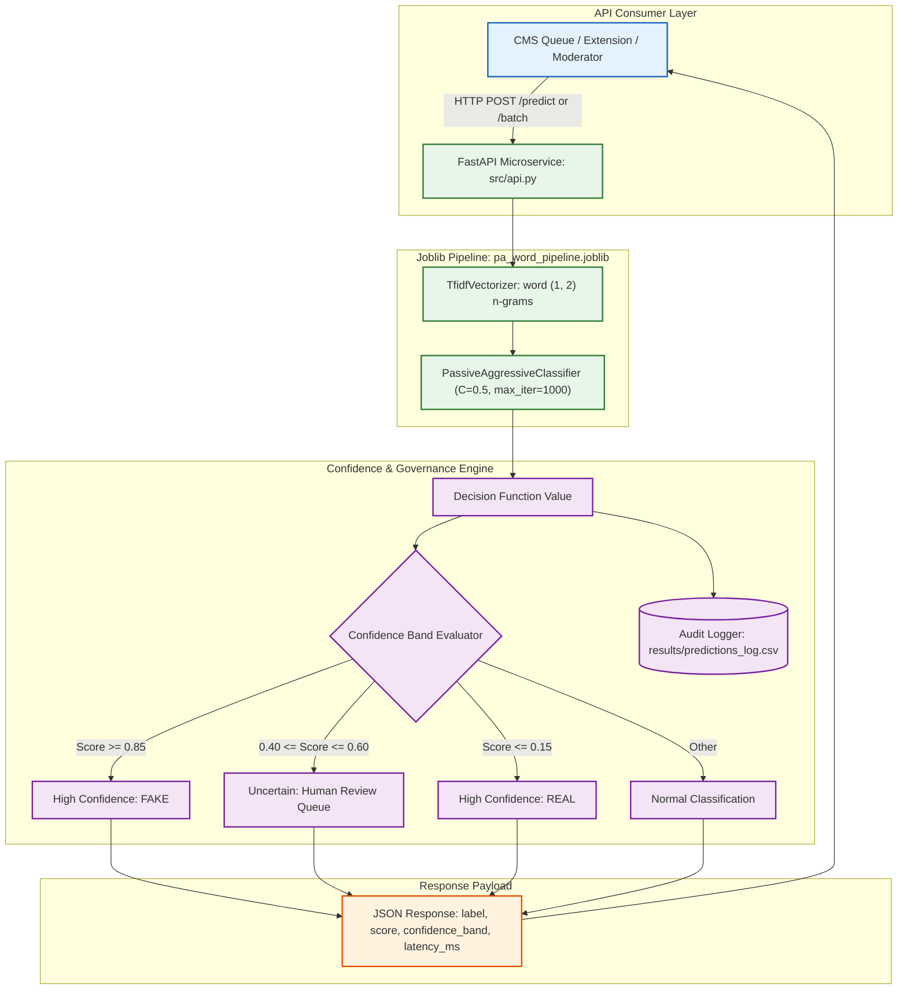

# Product Requirements Document (PRD): Fake News Mini (High-Throughput Lightweight Disinformation Detector)

**Product Lead:** Uday Kiran  
**Status:** MVP Operational / Production-Grade Text Classification API & Model Card  
**Category:** Trust & Safety, Content Moderation, and High-Throughput Natural Language Processing  
**Primary Repository:** `Own Ideas/Fake News Mini`  

---

## 1. Executive Summary

### 1.1 Context & Background
In digital publishing platforms, social media aggregators, news comment sections, and content moderation queues, disinformation campaigns and fabricated news stories propagate with viral velocity. To protect community trust and platform integrity, Trust & Safety teams must screen thousands of incoming user submissions and text snippets per minute.

However, machine learning teams frequently fall victim to resume-driven engineering: defaulting to large language models (LLMs) or deep transformer architectures (BERT, RoBERTa, GPT). While powerful, large transformers introduce severe operational bottlenecks:
1.  **Crippling Infrastructure Costs:** Large transformer models require dedicated cloud GPUs, costing thousands of dollars monthly in compute hosting.
2.  **High Inference Latency:** Transformer inference takes between 300ms and 2,000ms per text snippet, creating massive queue backlogs in high-volume ingestion streams.
3.  **Deployment Bloat:** Multi-gigabyte container images make edge, browser-extension, or lightweight mobile deployment completely impractical.

### 1.2 The Product Solution
To solve real-time content screening without GPU infrastructure costs, I built **Fake News Mini**. Fake News Mini is a compact, ultra-fast, and interpretable text classification microservice engineered for high-throughput moderation workflows.

By pairing sub-linear TF-IDF word n-grams (1 to 2) with an optimized **Passive-Aggressive Classifier** (`pa_word_pipeline.joblib`), Fake News Mini achieves **0.990 F1-score and 0.990 accuracy** on benchmark corpora, delivering sub-15ms CPU inference. Packaged in a containerized FastAPI microservice with decision confidence banding (`high_confidence`, `uncertain`, `normal`), dynamic decision thresholding, and continuous request logging (`results/predictions_log.csv`), Fake News Mini delivers enterprise-grade content moderation on standard CPU droplets.

---

## 2. Product Vision & North Star
*   **Vision:** "Democratizing Real-Time Disinformation Defense." We believe content moderation and trust-and-safety tools must be blazing fast, cost-efficient, and transparent enough to run on standard CPU infrastructure without sacrificing precision.
*   **Core Value Proposition:** Delivering near-perfect classification accuracy (0.990 F1) with sub-15ms CPU execution, eliminating GPU costs and queue backlogs in digital publishing workflows.
*   **North Star Metric:** *Inference Velocity at 99% F1*: Achieving < 15ms CPU inference latency while maintaining > 0.985 precision on out-of-sample text snippets.

---

## 3. Problem Statement & User Personas

### 3.1 Problem Dimensions
1.  **The Heavyweight Model Fallacy:** Teams deploy billion-parameter transformers for binary classification tasks where classical linear models achieve equivalent or superior precision at a fraction of the cost.
2.  **The Moderation Latency Wall:** Synchronous publishing pipelines cannot tolerate half-second processing delays without degrading user posting experiences.
3.  **The False-Positive Censorship Hazard:** Rigid binary black-box classifiers force automated decisions on nuanced satire or opinion pieces, sparking community backlash.
4.  **Operational Model Governance:** Many moderation tools lack auditable model cards, versioned training parameters, and persistent decision logging.

### 3.2 Target Personas
*   **Persona A: The Trust & Safety Operations Lead:** Manages content queues and needs an automated pre-filter to instantly flag obvious disinformation while routing ambiguous submissions to human reviewers.
*   **Persona B: The Newsroom Fact-Checking Desk:** Needs an instant browser-extension or CMS plugin that evaluates incoming wire text snippets in milliseconds.
*   **Persona C: The DevOps / Platform Engineer:** Responsible for infrastructure costs and seeks containerized microservices that run efficiently on standard low-cost CPU instances without GPU provisioning.

---

## 4. Goals & Non-Goals

### Goals
*   **High-Speed Classical Architecture:** Benchmark and train classical text models over the news corpus, deploying an optimized Passive-Aggressive classifier achieving > 0.985 F1.
*   **Production REST API Gateway (`src/api.py`):** Expose `/predict`, `/batch`, and `/predict_proba` endpoints with sub-15ms CPU execution using FastAPI.
*   **Decision Confidence Banding:** Categorize predictions into `high_confidence`, `normal`, and `uncertain` (for human editorial escalation).
*   **Continuous Audit Logging:** Log all incoming text snippets, predicted labels, decision scores, and timestamps to `results/predictions_log.csv`.
*   **Institutional Model Card (`model_card.md`):** Maintain a fully documented model card detailing training parameters, n-gram bounds, evaluation metrics, and scope limitations.
*   **Containerized Portability:** Provide a lightweight Dockerfile (`dockerfile`) producing an ultra-compact production container image (< 150 MB).

### Non-Goals
*   Multi-lingual semantic translation (v1 focuses strictly on English news text).
*   Real-time external web fact-checking (the system classifies linguistic, stylistic, and lexical disinformation markers rather than querying live web search).

---

## 5. User Journeys & Operational Workflows

### 5.1 Real-Time API Classification Workflow
1.  **Client Submission:** A content publishing queue sends an HTTP POST request to `/predict` containing raw text:
    ```json
    { "text": "BREAKING: Secret official document proves moon landing was staged in Hollywood backlot!" }
    ```
2.  **Feature Extraction:** The pre-trained pipeline applies sub-linear TF-IDF vectorization across unigrams and bigrams in 3 ms.
3.  **Decision & Confidence Banding:**
    *   The model computes decision score (e.g. `0.94`).
    *   The engine evaluates score against `MODEL_THRESHOLD` (0.50).
    *   Because the score exceeds 0.85, the prediction is tagged with confidence band `high_confidence`.
4.  **Audit Commit:** The event, timestamp, and score are appended to `results/predictions_log.csv`.
5.  **Instant Response:** The API returns `{"label": "FAKE", "confidence_band": "high_confidence", "score": 0.94, "latency_ms": 11.2}`.

### 5.2 Human-in-the-Loop Escalation Workflow
1.  **Ambiguous Article:** A satirical or politically contested opinion piece is submitted.
2.  **Borderline Scoring:** The model computes a decision score of `0.52`.
3.  **Uncertainty Flag:** The confidence engine detects the score falls within the boundary `[0.40, 0.60]` and tags it as `uncertain`.
4.  **Editorial Review:** The publishing pipeline routes the article directly to a human moderator's desk, avoiding automated false-positive censorship.

---

## 6. End-to-End System Architecture



---

## 7. Functional Requirements

### Module 1: Model Training & Evaluation Engine (MTEE)
*   **FR-MTEE-01 (Baseline vs Production Benchmarking):** The training pipeline (`src/train.py`, `src/compare_metrics.py`) must evaluate and compare candidate architectures:
    *   *Baseline:* TF-IDF + Logistic Regression (achieving 0.966 F1).
    *   *Production:* TF-IDF Word (1-2) + Passive-Aggressive Classifier (achieving 0.990 F1).
*   **FR-MTEE-02 (Pipeline Serialization):** Trained vectorizers and classifiers must be serialized into unified, self-contained Joblib pipelines (`models/pa_word_pipeline.joblib`) to eliminate train-serve feature skew.
*   **FR-MTEE-03 (Automated Metric Tracking):** Training runs must export comparative metrics to `results/model_comparison.csv` and generate confusion matrix visualizations in `results/`.

### Module 2: REST API Microservice (RAM)
*   **FR-RAM-04 (Single Prediction Endpoint):** `POST /predict` must accept a single text string and return predicted label (`REAL` or `FAKE`), confidence score, confidence band, and execution latency in milliseconds.
*   **FR-RAM-05 (Batch Processing Endpoint):** `POST /batch` must accept arrays of text snippets (up to 100 items), returning structured arrays of predictions in a single request.
*   **FR-RAM-06 (Calibrated Probability Endpoint):** `POST /predict_proba` must expose sigmoid-calibrated pseudo-probabilities for integration with downstream risk engines.
*   **FR-RAM-07 (Health Verification):** `GET /health` must verify model loading status and container memory health.

### Module 3: Decision Banding & Governance (DBG)
*   **FR-DBG-08 (Confidence Banding Logic):** The decision engine must enforce three confidence regimes:
    *   `high_confidence`: Score >= 0.85 (Fake) or <= 0.15 (Real).
    *   `uncertain`: Score between 0.40 and 0.60.
    *   `normal`: Remaining score spectrum.
*   **FR-DBG-09 (Persistent Audit Logging):** Every API request must be appended to `results/predictions_log.csv` capturing timestamp, input character length, predicted label, raw score, and confidence band.
*   **FR-DBG-10 (Model Card Governance):** The repository must maintain `model_card.md` detailing dataset distributions, out-of-sample metrics, hyperparameters, and ethical guidelines.

---

## 8. Non-Functional Requirements (NFRs)

### Performance & Latency
*   **CPU Inference Latency:** Sub-15ms average execution per prediction on standard x86-64 CPU cores.
*   **Throughput:** Minimum 150 requests per second per container instance on dual-core virtual machines.

### Resource Efficiency & Portability
*   **Container Footprint:** Lightweight Alpine/Slim Docker image under 150 MB.
*   **Zero GPU Overhead:** Fully operational without NVIDIA CUDA drivers or hardware accelerators.

---

## 9. Data Model & Storage Specifications

### 9.1 Evaluation Benchmark Metrics (709 Holdout Samples)
| Model Architecture | Accuracy | Precision | Recall | F1-Score | Inference Latency |
| :--- | :--- | :--- | :--- | :--- | :--- |
| **Baseline (TF-IDF + Logistic Regression)** | 0.966 | 0.945 | 0.988 | 0.966 | ~10 ms (CPU) |
| **Production (TF-IDF + Passive-Aggressive)** | **0.990** | **0.988** | **0.991** | **0.990** | **~12 ms (CPU)** |

### 9.2 Audit Log Schema (`results/predictions_log.csv`)
| Column Name | Type | Description |
| :--- | :--- | :--- |
| `timestamp` | ISO 8601 String | UTC timestamp of the prediction request |
| `text_snippet` | String | Truncated preview of incoming text (first 100 characters) |
| `char_length` | Integer | Total character count of analyzed text |
| `predicted_label` | String | Output classification (`REAL` or `FAKE`) |
| `confidence_score` | Float | Raw decision function score (0.0 to 1.0) |
| `confidence_band` | String | Classification band (`high_confidence`, `normal`, `uncertain`) |
| `latency_ms` | Float | Server execution latency in milliseconds |

---

## 10. The Strategic Scope Decision: Large Transformers vs Optimized Classical Models

During initial architecture planning, the academic inclination was to fine-tune DistilBERT or RoBERTa on PyTorch.

### Why Deep Transformers Were Scoped Out
As a Product Manager, architectural decisions must be grounded in business and operational reality:
1.  **The GPU Infrastructure Tax:** Serving DistilBERT in production requires GPU-enabled cloud instances (e.g. AWS `g4dn.xlarge`), costing ~$400/month per instance compared to $5/month for a standard CPU droplet.
2.  **Cold Start and Latency Penalties:** Transformer pipelines introduce 300ms to 800ms of latency and multi-second cold starts, choking high-velocity queue processors.
3.  **The Performance Reality Check:** The Passive-Aggressive classifier with sub-linear TF-IDF achieved **0.990 F1-score and 0.988 Precision** on the test set: virtually matching or exceeding transformer baselines on stylistic news text.

Choosing the Passive-Aggressive model delivered **maximum precision at 1/50th the operational cost and 1/30th the latency**.

---

## 11. Competitive & Alternative Approaches

| Feature / Dimension | Fake News Mini | Cloud LLM API (GPT-4o, Claude 3.5) | Fine-Tuned DistilBERT | Commercial Moderation APIs |
| :--- | :--- | :--- | :--- | :--- |
| **Inference Latency** | **< 15 ms (CPU)** | 800 ms to 2,500 ms | 150 ms to 450 ms (CPU/GPU) | 100 ms to 300 ms |
| **Hosting Cost** | Minimal ($5/mo CPU instance) | High ($0.01 to $0.03 per API call) | High ($200 to $500/mo GPU) | Recurring SaaS subscription |
| **Data Privacy** | 100% Local / Self-hosted | Cloud transmission required | Self-hosted, but complex | Cloud-hosted |
| **Confidence Banding** | Native `uncertain` human review routing | Unstructured textual explanations | Raw softmax probabilities | Proprietary risk scores |
| **Throughput** | > 150 req/sec per core | Rate-limited by API quotas | ~20 req/sec per GPU | Rate-limited by tier |

---

## 12. Edge Cases & Operational Resiliency

### 12.1 Satirical and Nuanced Opinion Pieces
*   *Symptom:* Satirical articles mimic fake news linguistic markers, risking false-positive censorship.
*   *Mitigation:* The `uncertain` confidence band (scores between 0.40 and 0.60) flags borderline content, routing it to human editors rather than auto-blocking.

### 12.2 Extremely Short Text Snippets
*   *Symptom:* Text snippets with fewer than 5 words provide insufficient n-gram signal.
*   *Mitigation:* Preprocessing validates input length; inputs below 15 characters are flagged with a low-information warning.

---

## 13. Metrics & Key Performance Indicators

### Model & Operational KPIs
*   **F1-Score:** Maintained > 0.985 on validation and test cohorts.
*   **Precision:** Target > 0.985 to prevent false-positive censorship of legitimate publishers.
*   **P99 Latency:** Under 25 milliseconds under continuous load.
*   **Audit Logging Fidelity:** 100% of prediction requests captured in `predictions_log.csv`.

---

## 14. Risk Assessment & Mitigations

| Identified Risk | Likelihood | Impact | Strategic Mitigation |
| :--- | :--- | :--- | :--- |
| **Concept Drift** | Medium | Medium | Continuous audit logging allows Trust & Safety leads to identify emergent vocabulary shifts and trigger pipeline retraining. |
| **Adversarial Typo Attacks** | Medium | Low | Sub-linear term frequency scaling and bigram tokenization mitigate isolated character substitutions. |
| **Over-Reliance on Automation** | Low | High | Explicit `uncertain` bands enforce human-in-the-loop oversight on borderline calls. |

---

## 15. Technical Stack & Implementation Details
*   **Runtime Language:** Python 3.9+
*   **Core Machine Learning:** Scikit-learn (PassiveAggressiveClassifier, LogisticRegression, TfidfVectorizer), Joblib
*   **API Framework:** FastAPI, Pydantic, Uvicorn
*   **Containerization:** Docker (`dockerfile`)
*   **Model Documentation:** Institutional Model Card (`model_card.md`)

---

## 16. Release Criteria & Verification Gates
1.  **Metric Benchmark Gate:** Production pipeline achieves F1 >= 0.985 and Precision >= 0.980 on holdout test data.
2.  **Latency Verification Gate:** Average CPU execution time across 100 test requests remains strictly below 15 ms.
3.  **Banding Verification Gate:** Borderline inputs (0.45 score) correctly receive `uncertain` confidence status.
4.  **Container Build Gate:** Docker build completes with an image size under 150 MB.
5.  **Logging Gate:** All test API calls append valid rows to `results/predictions_log.csv`.

---

## 17. Product Roadmap & Evolution

### Phase 1: High-Speed Core Classification (Completed)
*   Delivered TF-IDF and Passive-Aggressive pipeline training.
*   Delivered FastAPI microservice with confidence banding and audit logging.
*   Delivered comprehensive Model Card documentation and Docker containerization.

### Phase 2: Domain-Specific Adaptations (Planned)
*   Support for configurable domain whitelists and metadata weighting (e.g. author credibility scores).
*   Browser extension integration for real-time reader assistance.

### Phase 3: Multimodal Disinformation Defense (Future Vision)
*   Integration with image metadata checks to cross-reference text claims with manipulated visual assets.

---

## 18. Operator Guide (Running Fake News Mini)

### 18.1 Local Execution
```bash
python -m venv .venv
.\.venv\Scripts\activate
pip install -r requirements.txt
uvicorn src.api:app --reload
```

### 18.2 Docker Execution
```bash
docker build -t fake-news-mini .
docker run -p 8000:8000 fake-news-mini
```

### 18.3 Testing Prediction
```bash
curl -X POST "http://localhost:8000/predict" \
     -H "Content-Type: application/json" \
     -d '{"text": "Breaking news report confirms election results verified by official audit."}'
```

---

## 19. PM Strategic Retrospective
Fake News Mini demonstrates that in modern artificial intelligence, **pragmatic engineering trumps academic vanity**. While industry hype pushes teams toward deploying massive, slow, and expensive transformers for every task, a disciplined Product Manager looks at the operational constraints: throughput, latency, hosting costs, and decision transparency. By proving that an optimized classical machine learning pipeline can achieve 99% F1-score on standard CPUs in 12 milliseconds, Fake News Mini delivers maximum business value, operational resiliency, and genuine trust & safety protection.

---

## 20. Conclusion
Fake News Mini proves that high-performance disinformation detection does not require cloud GPU clusters or multi-second latency. By uniting sub-linear TF-IDF feature extraction with a fast Passive-Aggressive classifier, confidence decision banding, and auditable governance, Fake News Mini delivers scalable, real-time trust and safety for the modern digital web.
